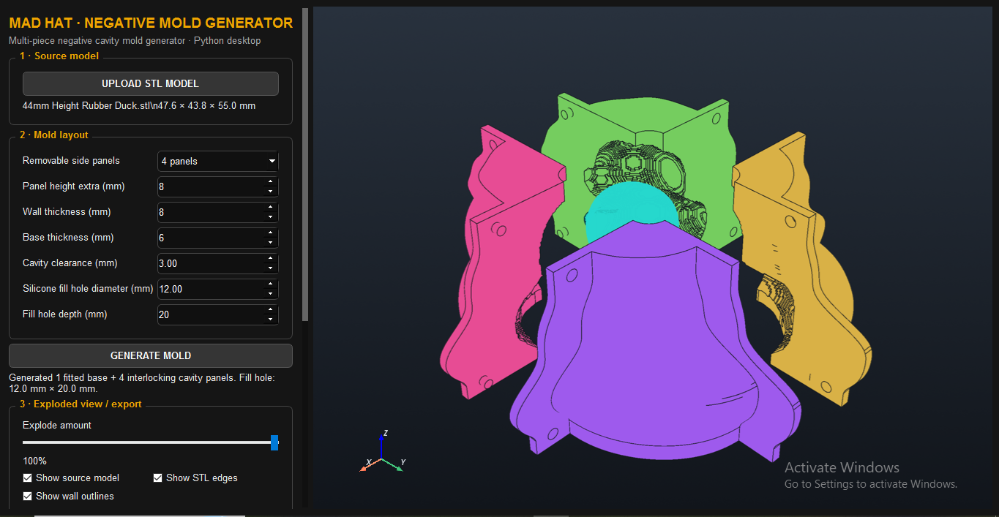
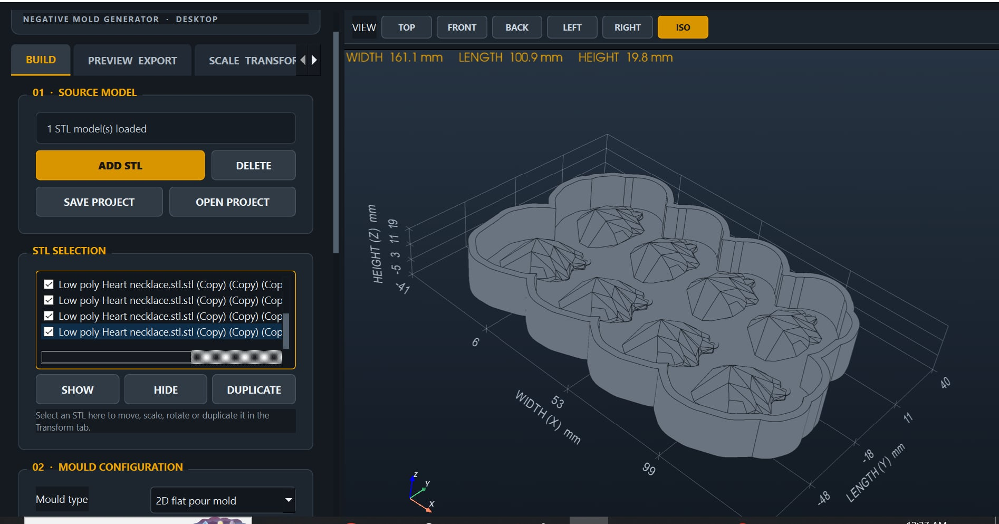

This is an experimental Script written mostly with Chat GPT 
IMPORTANT DISCLAIMER: This is my personal project and has only been tested by me
If you choose to run it, you do so entirely at your own risk. 
I am not responsible for any damage, malfunction, or personal injury that may result from the use or misuse of this script.
Use it with caution and at your own discretion.

How to install and run:

Beginners
Install Python 3.12 and add python to path during installation.
Download both files.
Move downloaded files to a seperate folder named "Mold Generator"
Open CMD
Copy folder location from the windows folder search bar
Type into CMD: "cd & folder location" replacing "& folder location" with your pasted folder location
Copy and paste into CMD: pip install -r requirements_MadHat_Mold_Generator.txt 

Pros
Download both files.
Open CMD in the downloaded folder.
Run: pip install -r requirements_MadHat_Mold_Generator.txt

Run the application
Copy and paste into CMD: python MadHat_Negative_Mold_Generator.py
or double click the python file

https://github.com/coatl-dev/python3.12-windows Python can be found here

